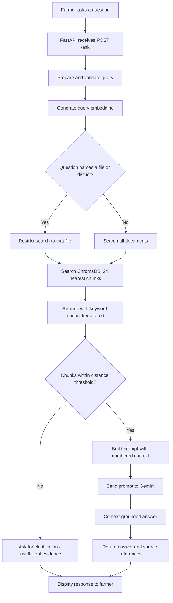

# Farmer Advisor RAG

A Retrieval-Augmented Generation (RAG) system that answers farmers' agricultural questions **from your own documents** instead of from the language model's memory. Every answer comes with source references (file and page), and when the documents don't contain enough information the system says so instead of guessing.

This repository is the RAG component of the Farmer Advisor System: document processing, retrieval and context-grounded answer generation, with a small web chat page on top.

---

## Table of contents

1. [Features](#features)
2. [How it works](#how-it-works)
3. [Tech stack](#tech-stack)
4. [Project structure](#project-structure)
5. [Getting started](#getting-started)
6. [Configuration](#configuration)
7. [Using the app](#using-the-app)
8. [API reference](#api-reference)
9. [Tuning retrieval quality](#tuning-retrieval-quality)
10. [Testing](#testing)
11. [Troubleshooting](#troubleshooting)
12. [Limitations](#limitations)
13. [Roadmap](#roadmap)

---

## Features

- **Grounded answers**: Gemini is instructed to answer only from the retrieved context.
- **Source references**: each answer lists the file, page, snippet and match score it used.
- **"I don't know" behaviour**: if no chunk passes the relevance threshold, the LLM is not called and the user is asked for more detail.
- **Table-friendly ingestion**: PDF table rows are kept on separate lines with cell borders marked, so values like rainfall or crop area stay readable.
- **Document labels on every chunk**: district or crop names from the file name are part of the embedded text, which fixes "wrong district" retrievals.
- **File-name filter**: if the question names a document or district (e.g. "Bagalkot"), search is restricted to that file.
- **Hybrid ranking**: vector similarity plus a small keyword bonus.
- **Multilingual retrieval**: a multilingual embedding model lets non-English questions match English documents.
- **Simple chat UI**: plain HTML, CSS and JavaScript, served by the same FastAPI app.

---

## How it works

The system has two phases.

### Phase 1: Ingestion (offline, run when documents change)

```
PDF files -> Load -> Clean -> Split into chunks -> Add document label -> Embed -> Store in ChromaDB
```

| Step | File | What happens |
|---|---|---|
| Load | `app/ingestion/document_loader.py` | Reads each PDF page by page (layout mode keeps tables apart) and records file name and page number |
| Clean | `app/ingestion/text_cleaner.py` | Re-joins hyphenated words, removes junk characters, keeps table rows on their own lines |
| Split | `app/ingestion/text_splitter.py` | ~800-character chunks with 150 characters of overlap; each chunk starts with `[file label \| page N]` |
| Embed | `app/retrieval/embeddings.py` | Converts each chunk to a normalized vector with a multilingual sentence-transformers model |
| Store | `app/retrieval/vector_store.py` | Saves vectors, text and metadata (source, page) in ChromaDB using cosine distance |
| Orchestrate | `app/ingestion/indexing.py` | Runs the whole pipeline and writes `data/processed/chunks.json` for inspection |

### Phase 2: Answering (online, every question)



| Step | File | What happens |
|---|---|---|
| Receive and validate | `app/api/routes.py`, `retriever.prepare_query` | Trims whitespace, rejects questions that are too short or too long |
| Embed question | `app/retrieval/embeddings.py` | Uses the same model as ingestion, so vectors share one space |
| File filter | `app/retrieval/retriever.py` | Matches distinctive words in the question to file names |
| Search and re-rank | `app/retrieval/retriever.py` | 24 candidates, vector score plus keyword bonus, top 6, distance threshold |
| Build prompt | `app/generation/prompt.py` | Instructions + numbered context + the question |
| Generate | `app/generation/llm.py` | Calls Gemini |
| Orchestrate | `app/services/rag_service.py` | Runs the steps above and shapes the response |

---

## Tech stack

| Component | Technology | Why |
|---|---|---|
| Backend API | FastAPI + Uvicorn | Request validation with Pydantic, automatic docs at `/docs` |
| Embeddings | sentence-transformers (`paraphrase-multilingual-MiniLM-L12-v2`) | Free, local, multilingual |
| Vector database | ChromaDB (persistent, cosine) | Embedded, stores text and metadata, supports filters |
| LLM | Google Gemini (`gemini-2.5-flash` by default) | Fast, multilingual, easy API |
| PDF parsing | pypdf | Page-level text extraction |
| Frontend | HTML, CSS, JavaScript | No build step |
| Tests | pytest | Unit tests for ingestion and retrieval logic |

---

## Project structure

```
farmer-advisor-rag/
├── app/
│   ├── main.py                  # FastAPI app, serves the UI
│   ├── config.py                # Settings loaded from .env
│   ├── api/
│   │   └── routes.py            # /ask and /health endpoints
│   ├── ingestion/
│   │   ├── document_loader.py   # Load PDFs / text files
│   │   ├── text_cleaner.py      # Clean extracted text
│   │   ├── text_splitter.py     # Chunking + document labels
│   │   └── indexing.py          # Ingestion pipeline entry point
│   ├── retrieval/
│   │   ├── embeddings.py        # Sentence-transformers wrapper
│   │   ├── vector_store.py      # ChromaDB access
│   │   └── retriever.py         # Search, filter, re-rank, threshold
│   ├── generation/
│   │   ├── prompt.py            # Prompt construction
│   │   └── llm.py               # Gemini client
│   ├── services/
│   │   └── rag_service.py       # End-to-end RAG flow
│   └── static/
│       ├── index.html           # Chat page
│       ├── style.css
│       └── script.js
├── data/
│   ├── raw/                     # Put your PDFs here
│   └── processed/               # chunks.json written by indexing
├── chroma_db/                   # Vector database (generated)
├── tests/
│   ├── test_ingestion.py
│   └── test_retrieval.py
├── .env                         # Your settings and API key (not committed)
├── .gitignore
├── requirements.txt
└── README.md
```

---

## Getting started

### Prerequisites

- Python 3.10 or newer
- A Gemini API key (create one in Google AI Studio)
- About 1 GB of free disk space (the embedding model downloads about 400 MB on first use)

### 1. Create a virtual environment and install dependencies

**Windows**

```bash
python -m venv .venv
.venv\Scripts\activate
pip install -r requirements.txt
```

**macOS / Linux**

```bash
python -m venv .venv
source .venv/bin/activate
pip install -r requirements.txt
```

### 2. Add your Gemini API key

Open `.env` and set:

```
GEMINI_API_KEY=your_real_key_here
```

Never commit `.env`; it is already listed in `.gitignore`.

### 3. Add your documents

Copy your PDFs (or `.txt` / `.md` files) into `data/raw/`.

Tip: **name files descriptively**, for example `KA1-Bagalkot_31.1.2011.pdf` or `Tomato_Disease_Guide.pdf`. The file name becomes part of every chunk and is used by the file-name filter.

### 4. Build the knowledge base

```bash
python -m app.ingestion.indexing --reset
```

`--reset` deletes and rebuilds the collection. Run it again whenever you add, remove or change documents, or change chunking settings. The first run downloads the embedding model.

### 5. Start the server

```bash
uvicorn app.main:app --reload
```

Open http://localhost:8000 for the chat page, or http://localhost:8000/docs for the interactive API docs.

---

## Configuration

All settings live in `.env` (defaults are shown).

| Variable | Default | Meaning |
|---|---|---|
| `GEMINI_API_KEY` | (empty) | Your Gemini API key |
| `GEMINI_MODEL` | `gemini-2.5-flash` | Gemini model name |
| `EMBEDDING_MODEL` | `sentence-transformers/paraphrase-multilingual-MiniLM-L12-v2` | Embedding model |
| `CHROMA_DIR` | `chroma_db` | Where the vector database is stored |
| `COLLECTION_NAME` | `farmer_advisor` | ChromaDB collection name |
| `RAW_DATA_DIR` | `data/raw` | Input documents |
| `PROCESSED_DATA_DIR` | `data/processed` | Output for `chunks.json` |
| `CHUNK_SIZE` | `800` | Characters per chunk |
| `CHUNK_OVERLAP` | `150` | Characters shared between neighbouring chunks |
| `TOP_K` | `6` | Chunks sent to the LLM after re-ranking |
| `MAX_DISTANCE` | `0.65` | Relevance cutoff (cosine distance; lower is stricter) |

Changing `EMBEDDING_MODEL`, `CHUNK_SIZE` or `CHUNK_OVERLAP` requires re-running the indexing command with `--reset`.

---

## Using the app

### Chat page

Type a question and press **Ask**. The answer appears with a collapsible **Sources** list. A yellow bubble means the system had no sufficiently relevant context and did not call Gemini.

### Example questions

Questions work best when they name the place or crop:

- "What is the normal annual rainfall in Bagalkot?"
- "Which crops are grown most in Bellary?"
- "How much money do farmers get under PM-KISAN?"
- "When should sorghum be sown in kharif in Bagalkot?"

### Command line

```bash
curl -X POST http://localhost:8000/ask \
  -H "Content-Type: application/json" \
  -d '{"question": "What is the normal annual rainfall in Bagalkot?"}'
```

---

## API reference

### `POST /ask`

Request:

```json
{ "question": "What is the normal annual rainfall in Bagalkot?" }
```

Response:

```json
{
  "answer": "The normal annual rainfall in Bagalkot is 585 mm [1].",
  "grounded": true,
  "sources": [
    {
      "source": "KA1-Bagalkot_31.1.2011.pdf",
      "page": 1,
      "score": 0.71,
      "snippet": "[KA1 Bagalkot 31.1.2011 | page 1] SW monsoon (June-Sep): | 360 | 25 ..."
    }
  ]
}
```

| Field | Meaning |
|---|---|
| `answer` | Generated answer, or the "not enough information" message |
| `grounded` | `true` if the answer was generated from retrieved context, `false` if no relevant context was found |
| `sources[].score` | `1 - cosine distance`; higher is a closer match |

Errors: `422` for an invalid question (too short or too long), `500` for server problems such as a missing API key.

### `GET /health`

Returns `{"status": "ok"}`.

---

## Tuning retrieval quality

If answers are wrong or the system refuses too often, work through this list:

1. **Inspect `data/processed/chunks.json`.** Search for the term you asked about. If the text is garbled or the table is scrambled, the problem is extraction, not retrieval.
2. **Adjust `MAX_DISTANCE`.** Too strict gives false "not enough information"; too loose lets irrelevant context through. Test with questions you know the answer to.
3. **Adjust chunk size and overlap.** Larger chunks keep more context; smaller chunks are more precise.
4. **Name files descriptively.** The file label is embedded with each chunk and drives the file-name filter.
5. **Increase `TOP_K`** if the answer needs information from several passages.
6. **Check the Sources list** in the UI to see what the model was actually given.

---

## Testing

```bash
pytest
```

The tests cover text cleaning, chunking, query validation, file-name detection, distance filtering and keyword re-ranking. They do not need the embedding model, ChromaDB or a Gemini key.

---

## Troubleshooting

| Problem | Likely cause and fix |
|---|---|
| `GEMINI_API_KEY is not set` | Put your key in `.env` and restart the server |
| "No documents found in data/raw" | Add PDFs to `data/raw/` before indexing |
| Answers still reflect old documents | Re-run `python -m app.ingestion.indexing --reset` |
| First indexing run is slow | The embedding model (about 400 MB) is downloading |
| Always "not enough information" | Raise `MAX_DISTANCE` a little (for example 0.75), or ask a more specific question |
| Wrong district or crop in results | Check file names, then re-index with `--reset` |
| Scanned PDF returns no text | The PDF is an image; run OCR on it first |
| Garbled characters in a PDF | Fonts without a text mapping; try another copy of the document |

---

## Limitations

- Answers are only as good as the documents in `data/raw/`. For fertilizer or pesticide advice, use authoritative sources and verify before acting.
- RAG reduces hallucination but does not eliminate it. Gemini's citations are not automatically verified against the sources.
- `MAX_DISTANCE` and the keyword weight are hand-tuned, not formally evaluated.
- The file-name filter depends on distinctive words in file names.
- No conversation memory: each question is answered on its own.
- Image-only pages (maps, scanned pages) are not searchable.
- No live data such as today's market prices.
- Multilingual retrieval does not by itself produce answers in the farmer's language; the prompt asks Gemini to reply in the question's language, which should be tested per language.

---

## Roadmap

- Build a golden question set and measure recall@k and answer faithfulness.
- Hybrid search (BM25 + vectors) and a cross-encoder re-ranker.
- Validate Gemini's citations against the retrieved sources in the backend.
- Table-aware parsing (for example with pdfplumber) for complex tables.
- Conversation memory and follow-up questions.
- Speech input and Kannada, Hindi and Telugu interface text.
- Incremental indexing and scheduled re-indexing.
- Docker setup for deployment.
